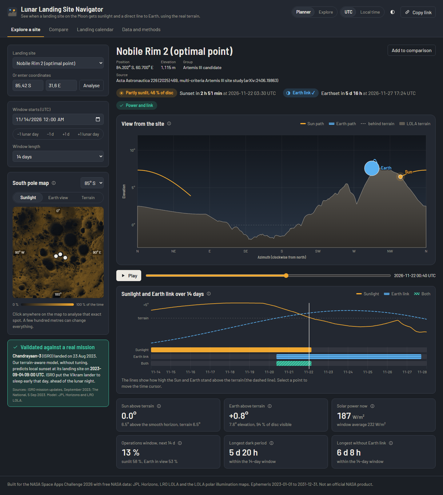
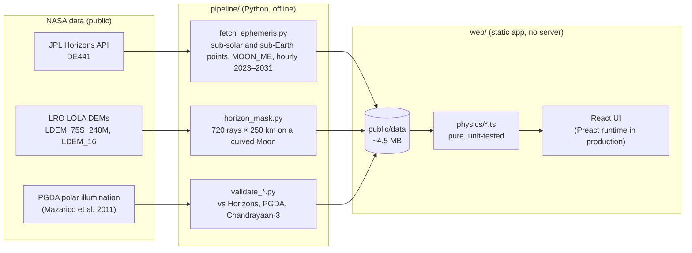

# Lunar Landing Site Navigator

**When does a landing site on the Moon get sunlight and a direct line to Earth, given the real terrain?**
This project is for the NASA Space Apps Challenge 2026: [Lunar Landing Site Navigator](https://www.spaceappschallenge.org/2026/challenges/lunar-landing-site-navigator/).



At the lunar south pole the Sun skims the horizon, often less than 2° up. A single ridge decides whether a lander has power, and Earth's monthly wobble decides whether it can call home. Existing tools (Quickmap, Moon Trek, JPL Horizons) hold the data, but comparing sites and dates means juggling all three.

This tool answers the question in seconds:
- It plots the Sun's and Earth's paths against the **real LRO LOLA terrain horizon**.
- It counts down to sunset and Earthset.
- It compares sites and dates side by side.
- When a launch slips, it shows which landing days still work.

It serves mission planners (Planner mode) and students and the public (Explore mode, which adds plain-language explanations).

**Live demo:** _add the GitHub Pages URL here after the first deploy (see "Deploy")._

## Features
- **Explore a site:**
  - 17 cited sites: Artemis III candidates, CLPS landers, Apollo, Chandrayaan-3, SLIM, Chang'e 4.
  - Custom coordinates, or click anywhere on the south polar map.
  - A 360° sky panorama with the terrain silhouette, Sun and Earth paths, and a hover readout.
  - Status chips, countdowns, a time scrubber and playback.
- **Compare:** site/date scenarios aligned by days since landing. ▲/▼ deltas against a baseline, with the best value outlined.
- **Landing calendar:** set the mission length, the minimum days of uninterrupted sun and the minimum Earth-link percentage. Every viable landing day lights up, including "if the launch slips a month".
- **Data and methods:** datasets, assumptions, limitations, and validation against JPL Horizons, the LOLA team's maps and a real mission.
- **Usability:**
  - Every metric has an ⓘ explaining what it means, how it's computed and where the data comes from.
  - UTC or local time; dark or light theme.
  - Shareable URLs ("Copy link" restores the exact view).
  - Keyboard control: <kbd>←</kbd>/<kbd>→</kbd> moves an hour, <kbd>Shift</kbd> moves a day, <kbd>Space</kbd> plays.

## How it works



1. **Sun and Earth.** For every hour from 2023 to 2031, Horizons gives the sub-solar and sub-Earth points on the Moon in the body-fixed frame. The browser turns them into azimuth and elevation for *any* lunar coordinate, including libration. A 6-hour file is shipped and interpolated back to hourly in the browser, which adds no measurable error.
2. **Real horizon.** For each site we cast 720 rays out to 250 km over LOLA terrain, using exact spherical geometry: the curvature drop d²/2R with R = 1737.4 km, no refraction. Custom spots are computed in the browser from a 960 m grid.
3. **Mission meaning.** Sunrise and sunset happen when the **upper limb** crosses the terrain. Partial visibility is the disc area above the horizon. From these windows we derive countdowns, the operations window, the longest dark period, power and the landing calendar.

## Validation (details: [docs/VALIDATION.md](docs/VALIDATION.md))
| Check | Result |
|---|---|
| Sun and Earth elevation vs JPL Horizons topocentric, 3 sites × 3 times (browser code path, unit-tested) | worst **0.0034°** (the Sun's disc is 0.533° wide) |
| Sunlit and Earth-visible % vs LOLA team maps, 7 polar sites | within **1–7 percentage points** |
| Chandrayaan-3 (2023): predicted local sunset | **2023-09-04 09:00 UTC**. ISRO put Vikram to sleep early that day, ahead of the lunar night |
| Shackleton crater floor over a full year | **0 %** sunlit (permanent shadow), as expected |

## Run locally
```bash
cd web
npm install
npm run dev        # http://localhost:5173
npm test           # 41 unit tests (physics, URL state, Horizons cross-check)
npm run lint && npm run build
```

Playwright smoke tests (Python):
```bash
pip install playwright && python -m playwright install chromium
cd web && npx vite preview --port 4173 &
python ../tests/e2e/smoke_test.py http://localhost:4173/
```

Rebuild the data (about 200 MB of NASA downloads into `pipeline/raw/`, which is gitignored):
```bash
cd pipeline
python -m venv .venv && .venv/Scripts/pip install numpy requests rasterio pyproj playwright
.venv/Scripts/python fetch_ephemeris.py       # JPL Horizons -> ephem.bin
.venv/Scripts/python horizon_mask.py          # LOLA -> sites.json, browser DEMs
.venv/Scripts/python export_overlays.py       # PGDA -> map overlays
.venv/Scripts/python validate_ephemeris.py    # vs Horizons topocentric
.venv/Scripts/python validate_illumination.py # vs PGDA maps
.venv/Scripts/python validate_missions.py     # Chandrayaan-3
.venv/Scripts/python validation_table.py      # docs/VALIDATION.md + test fixture
.venv/Scripts/python make_brand_assets.py     # OG image and favicons
```
The DEMs come from `http://imbrium.mit.edu/DATA/LOLA_GDR/` (`POLAR/IMG/LDEM_75S_240M.*`, `CYLINDRICAL/IMG/LDEM_16.*`). The illumination maps come from `https://pgda.gsfc.nasa.gov/data/MoonIllumination/` (`AVGVISIB_75S_120M_201608.TIF`, `..._EARTH.TIF`).

## Deploy
Push to `main` and `.github/workflows/pages.yml` builds, tests and publishes to GitHub Pages. In the repo settings, set Pages to use GitHub Actions. `ci.yml` runs lint, format check, unit tests, build and the Playwright smoke tests on every push.

## Tech stack
TypeScript (strict), React 19 API (Preact runtime in production builds), Vite, Vitest, ESLint, Prettier, hand-written SVG and canvas charts, and Python (NumPy, rasterio, Playwright) for the data pipeline. Design system: [docs/DESIGN_SYSTEM.md](docs/DESIGN_SYSTEM.md).

## References
**NASA data**
- JPL Horizons System, DE441. https://ssd.jpl.nasa.gov/horizons/ (API retrieved 2026-11-14)
- LRO LOLA Gridded Data Records LDEM_75S_240M and LDEM_16 (Smith et al., LOLA team), NASA PDS. http://imbrium.mit.edu/DATA/LOLA_GDR/
- Mazarico, E., Neumann, G. A., Smith, D. E., Zuber, M. T., Torrence, M. H. (2011). Illumination conditions of the lunar polar regions using LOLA topography. *Icarus* 211, 1066–1081. Data: https://pgda.gsfc.nasa.gov/products/69
- LROC QuickMap (context and site checks): https://quickmap.lroc.asu.edu/
- CSA Moon Exploration portal (Space Agency Partner resource): https://www.asc-csa.gc.ca/eng/astronomy/moon-exploration/

**Landing-site coordinates** (each site also shows its source in the app)
- Artemis III 2023 workshop abstract #2036 (Connecting Ridge, Peak near Shackleton): https://www.hou.usra.edu/meetings/Artemis_III_2023/pdf/2036.pdf
- Evaluating potential landing sites for the Artemis III mission, *Acta Astronautica* 226 (2025) 469 (Nobile Rim 2): https://arxiv.org/abs/2406.19863
- IM-1 (LROC), IM-2 (Wikipedia "IM-2"), Blue Ghost Mission 1 (LROC/Firefly), Apollo 11–17 (LROC/NASA), Chandrayaan-3 (ISRO), SLIM (JAXA), Chang'e 4 (LROC). Sites marked "Needs verification" are flagged in the app.

**Mission record (validation)**
- The National, 5 Sep 2023, "India's Chandrayaan-3 mission lander and rover in sleep mode for lunar night".
- India TV News, 21 Sep 2023, on the 22 Sep wake-up attempt.

**Software** (all open source): React, Preact, Vite, Vitest, TypeScript, ESLint, Prettier, Playwright, NumPy, rasterio, pyproj, requests. **Fonts:** Barlow and Barlow Semi Condensed (Jeremy Tribby, SIL OFL), via Google Fonts.
**Images:** all original. The favicon and OG image are hand-coded SVG drawn from our own LOLA horizon data. No NASA logos or insignia are used, and no AI-generated images.

## Use of AI
We used an AI coding assistant. Every task is logged in [docs/AI_USAGE.md](docs/AI_USAGE.md), as the Space Apps rules require.

## Team
_Add team member names and roles here._

## License
MIT for the code ([LICENSE](LICENSE)). The NASA data is public domain; please cite the sources above.
